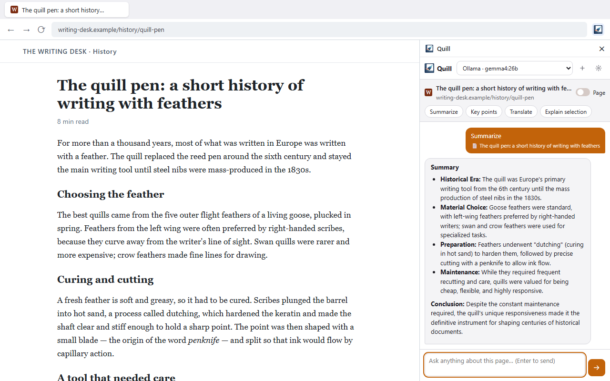
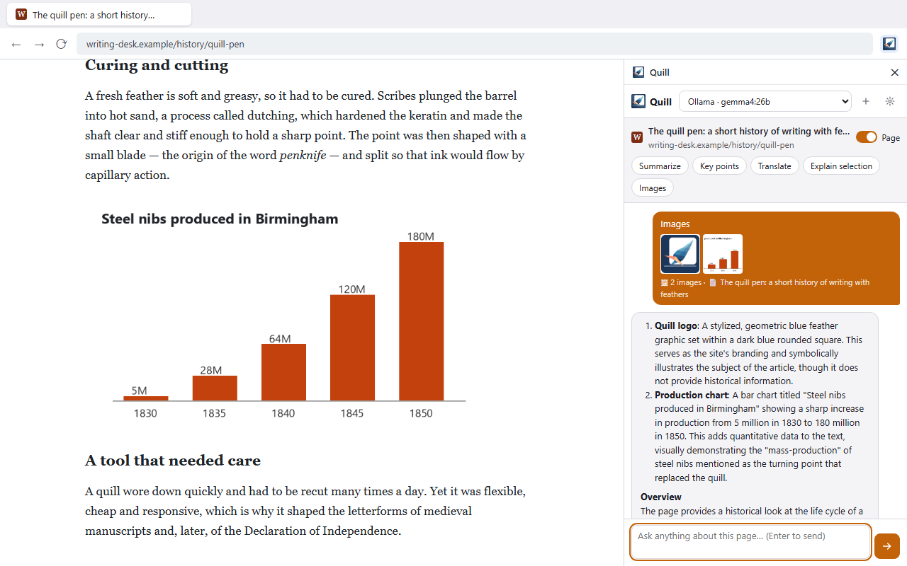
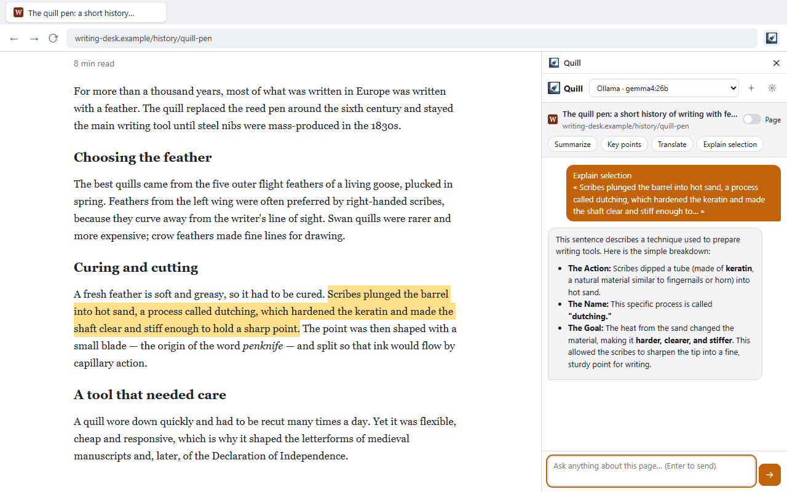
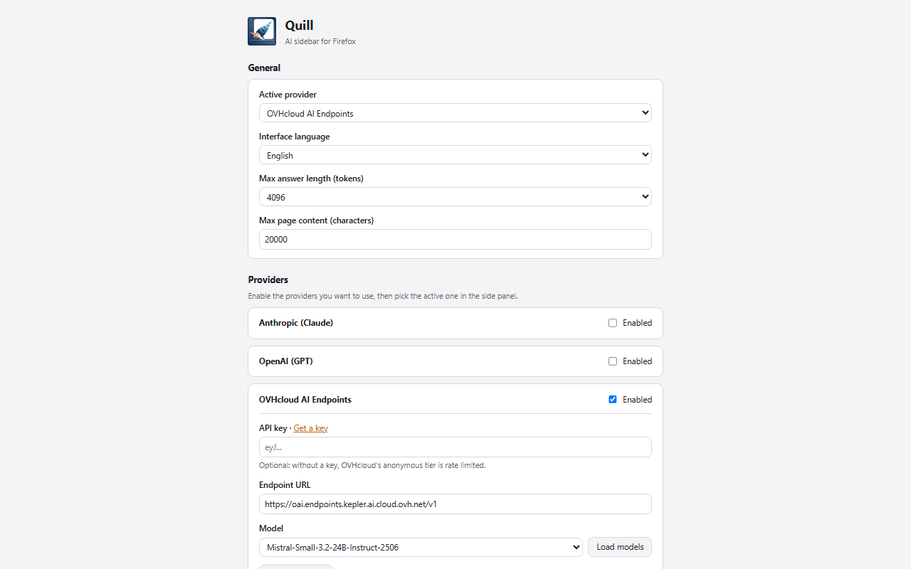

# ✒️ Quill for Firefox — v0.1

The Quill chat in a Firefox **sidebar** (which you can put on the right), with the same providers as [Quill for Thunderbird](https://github.com/mikecastrodemaria/Quill) and the ability to **talk with the current page**.

Full specification: [SPECIFICATION.md](SPECIFICATION.md). Chromium version: [Quill-Chrome](https://github.com/mikecastrodemaria/Quill-Chrome).



| Describe the page images | Explain a selection | Settings |
|---|---|---|
|  |  |  |

## v0.1 features

- Sidebar toggled from the Quill toolbar button or `Alt+Shift+Q`
- Multi-turn chat, Markdown rendering, Copy button, conversation kept for the browser session
- Providers: **Anthropic (Claude)**, **OpenAI**, **OVHcloud AI Endpoints**, **Ollama** (local), switchable from the sidebar header
- "Current page" card (favicon, title, URL) following the active tab
- **Page** toggle: attaches the page title, URL and text to your message (once per page)
- Quick actions: Summarize, Key points, Translate, Explain selection, **Images**
- **Image description** (v0.2): the **Images** button sends the main images of the page (up to 4, icons skipped) to a vision model; right click an image → "Quill: describe this image". With **Page** on, the page text is sent too, so the answer relates each image to the article. Images are resized to 1024 px and never stored. Needs a vision model: Claude, gpt-4o, OVHcloud Mistral-Small-3.2, Ollama gemma / llava / qwen2.5vl…
- Right click: "Quill: summarize this page", "explain / translate the selection", "describe this image"
- Options page: API keys, endpoint URLs, live model lists, connection test, FR/EN interface, limits

Requires **Firefox 140 or later** (desktop) — the first version with Firefox's built-in data collection consent.

## Install / test

### Option A — temporary add-on (no tools needed)

1. Clone the repository:
   ```powershell
   git clone https://github.com/mikecastrodemaria/Quill-Firefox.git
   ```
2. Open `about:debugging#/runtime/this-firefox`.
3. Click **Load Temporary Add-on…** and select `manifest.json` at the repository root.
4. Open `about:addons` → **Quill** → **Permissions** and check that the API sites are allowed (turn on **Access your data for all websites** if you want page reading without being asked).
5. Open the options (`about:addons` → Quill → ⋯ → **Options**): enable a provider, enter its API key, **Test connection**.
6. Click the Quill toolbar button (or `Alt+Shift+Q`): the sidebar opens.
7. To put it on the right: open the sidebar's **Customize sidebar** panel (or, with the classic sidebar, the menu next to the sidebar title) and choose **Move sidebar to right**.

A temporary add-on is removed when Firefox closes. After editing the code, click **Reload** on the Quill card in `about:debugging`.

### Option B — `web-ext` (auto-reload, lint)

Requires Node.js.

```powershell
npx web-ext run --source-dir .
```

```powershell
npx web-ext lint --source-dir . --ignore-files "*.md" "screenshots" "screenshots/**"
```

`web-ext run` starts a clean Firefox profile with the add-on installed and reloads it on every file change.

### Test checklist

| # | Test | Expected |
|---|---|---|
| 1 | Ask "Hello" | An answer appears; a follow-up question keeps the context |
| 2 | Open a Wikipedia article → **Summarize** | Firefox may ask for site access (**Allow**), then a summary of the article |
| 3 | Turn on **Page**, ask a question about the article | The answer uses the page content; the message shows a 📄 tag |
| 4 | Switch tabs | The context card follows the active tab |
| 5 | Select a paragraph → right click → **Quill: explain the selection** | The sidebar opens and explains the text |
| 6 | Open `about:preferences` | "This page can't be read", chat still works |
| 7 | Change the provider in the header | The next answer comes from that provider |
| 8 | Enter a wrong API key and ask something | Clear error message, the question stays in the input |
| 9 | With a vision model, open an article with pictures → **Images** | Thumbnails in your message, then a description of each image |
| 10 | Right click a picture → **Quill: describe this image** | The sidebar opens and describes that image |

**Debugging:** `about:debugging` → Quill → **Inspect** opens the DevTools for the add-on (background, sidebar and options pages).

### Ollama

Ollama rejects requests from extensions by default. Start it with:

```powershell
$env:OLLAMA_ORIGINS = "moz-extension://*"; ollama serve
```

## Page access

A page is read only when you turn on **Page** or run an action. Site access is an optional permission, requested on first use and revocable in `about:addons`. Firefox never lets add-ons read its own pages (`about:…`), addons.mozilla.org or the built-in PDF viewer.

Data only travels between your browser and the provider you chose: no Quill server, no telemetry.

## Differences from Quill-Chrome

| | Chrome | Firefox |
|---|---|---|
| Panel API | `sidePanel` (always on the right) | `sidebar_action` (left or right) |
| Background | service worker | event page (`background.scripts`) |
| Context menu API | `contextMenus` | `menus` |
| Shortcut | `Alt+Q` | `Alt+Shift+Q` |
| Ollama origin | `chrome-extension://*` | `moz-extension://*` |

## Structure

```
Quill-Firefox/
├── manifest.json        Manifest V3 (gecko id, sidebar_action)
├── background.js        Event page: toolbar button → sidebar, context menus
├── core/
│   ├── API.js           ⇐ copy of plugin/html/API.js from Quill
│   ├── providers.js     ⇐ copy of plugin/html/providers.js from Quill
│   ├── compat.js        fallback shim (Firefox already has `browser.*`)
│   ├── page.js          reads the active tab
│   ├── images.js        finds, loads and resizes page images (shared)
│   ├── markdown.js      safe Markdown renderer
│   └── i18n.js          FR / EN strings
├── sidebar/             sidebar UI
├── options/             options page
└── _locales/            add-on name and description
```

`core/API.js` and `core/providers.js` are **identical** to those of [Quill for Thunderbird](https://github.com/mikecastrodemaria/Quill) and Quill-Chrome: any fix to the provider layer must be applied to all of them.

## Package / publish

### Unsigned package (testing)

```powershell
npx web-ext build --source-dir . --ignore-files "*.md" ".gitignore" "screenshots" "screenshots/**" --overwrite-dest --filename "quill-firefox-{version}.xpi"
```

Produces `web-ext-artifacts/quill-firefox-<version>.xpi`. Release Firefox only accepts it as a temporary add-on; Developer Edition / Nightly accept it permanently with `xpinstall.signatures.required = false`.

### Signed package (self-distribution, not listed on AMO)

1. Get your API credentials at <https://addons.mozilla.org/developers/addon/api/key/> (JWT issuer + JWT secret). Never commit them.
2. Bump `version` in `manifest.json` if this version was already uploaded to AMO, listed or not (AMO answers `409 Version x already exists`).
3. Run, in PowerShell, from the repository root (the secret is typed hidden and cleared afterwards):
   ```powershell
   cd D:\Github\Quill-Firefox; $env:WEB_EXT_API_KEY = Read-Host "JWT issuer"; $env:WEB_EXT_API_SECRET = [Net.NetworkCredential]::new("", (Read-Host "JWT secret" -AsSecureString)).Password; npx web-ext sign --source-dir . --channel unlisted --ignore-files "*.md" ".gitignore" "screenshots" "screenshots/**"; Remove-Item Env:WEB_EXT_API_SECRET
   ```
4. Mozilla validates and signs the add-on (usually a few minutes); the signed `.xpi` is downloaded into `web-ext-artifacts/`.
5. Install it in any Firefox ≥ 140: drag the `.xpi` onto a Firefox window, or `about:addons` → ⚙ → **Install Add-on From File…**.

Use `--channel listed` instead to publish on addons.mozilla.org (requires a listing and a privacy policy).

### Publish on addons.mozilla.org

Listing texts, reviewer notes and permission justifications: [STORE_LISTING.md](STORE_LISTING.md). Privacy policy: [PRIVACY.md](PRIVACY.md).

### Data collection

`manifest.json` declares `data_collection_permissions` (required by addons.mozilla.org): `websiteContent` and `browsingActivity`, because the text and URL of a page are sent to the AI provider you configured when you use **Page** or a quick action. Firefox shows this at install time. Privacy policy: [PRIVACY.md](PRIVACY.md).

## License

GPL-3.0 — Supersonique Studio SARL.
